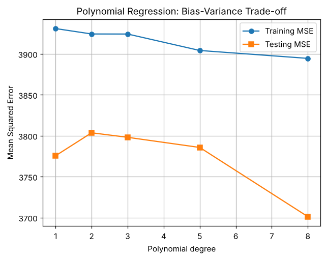

# Practical 4 — Polynomial Regression and the Bias–Variance Trade-off

**Dataset:** Diabetes (single feature: column index 2 = `bmi`) · **File:** [`practical_04_polynomial_regression.py`](practical_04_polynomial_regression.py)

## 1. Aim
Fit polynomial models of degree 1, 2, 3, 5 and 8, compare training vs testing error, and explain underfitting, overfitting and the bias–variance trade-off.

## 2. Theory

### Polynomial regression
Still a *linear model in its parameters*, but the input is expanded: for degree d, x → [x, x², …, xᵈ]:
ŷ = β₀ + β₁x + β₂x² + … + β_d xᵈ.
`PolynomialFeatures(degree, include_bias=False)` builds these columns; `LinearRegression` fits them.

### Bias–Variance trade-off
Expected test error = **Bias² + Variance + Irreducible noise**.
* **Bias** – error from over-simple assumptions → **underfitting** (high train *and* test error).
* **Variance** – sensitivity to the particular training sample → **overfitting** (low train error, high test error).
* Increasing degree: bias ↓, variance ↑. The best model is at the sweet spot where *test* error is lowest.

| Situation | Train error | Test error |
|---|---|---|
| Underfitting | high | high |
| Good fit | low | low (close to train) |
| Overfitting | very low | high (large gap) |

## 3. Code walkthrough
| Step | Explanation |
|---|---|
| Select feature | `data.data[:, [2]]` keeps a 2-D column (needed by sklearn) for the BMI feature. |
| Split | 75/25, `random_state=42`. |
| Loop over degrees | For each degree: expand features (`fit_transform` on train, `transform` on test), fit `LinearRegression`, store training and testing MSE. |
| Plot | Training MSE and Testing MSE against polynomial degree. |

### Full code
```python
import numpy as np
import matplotlib.pyplot as plt
from sklearn.datasets import load_diabetes
from sklearn.model_selection import train_test_split
from sklearn.preprocessing import PolynomialFeatures
from sklearn.linear_model import LinearRegression
from sklearn.metrics import mean_squared_error

data = load_diabetes()
# Use one feature to make the fitted curves easy to visualize
X = data.data[:, [2]]
y = data.target
X_train, X_test, y_train, y_test = train_test_split(
    X, y, test_size=0.25, random_state=42)

degrees = [1, 2, 3, 5, 8]
train_errors, test_errors = [], []

for degree in degrees:
    poly = PolynomialFeatures(degree=degree, include_bias=False)
    Xtr = poly.fit_transform(X_train)
    Xte = poly.transform(X_test)
    model = LinearRegression()
    model.fit(Xtr, y_train)
    train_errors.append(mean_squared_error(y_train, model.predict(Xtr)))
    test_errors.append(mean_squared_error(y_test, model.predict(Xte)))
    print(f"Degree {degree}: train MSE={train_errors[-1]:.2f}, "
          f"test MSE={test_errors[-1]:.2f}")

plt.plot(degrees, train_errors, marker="o", label="Training MSE")
plt.plot(degrees, test_errors, marker="s", label="Testing MSE")
plt.xlabel("Polynomial degree")
plt.ylabel("Mean Squared Error")
plt.title("Polynomial Regression: Bias-Variance Trade-off")
plt.legend()
plt.grid(True)
plt.show()
```

### Output
```text
Degree 1: train MSE=3930.99, test MSE=3775.62
Degree 2: train MSE=3924.39, test MSE=3803.66
Degree 3: train MSE=3924.33, test MSE=3798.12
Degree 5: train MSE=3904.22, test MSE=3785.76
Degree 8: train MSE=3894.58, test MSE=3701.23
```



## 4. Interpretation
* Training MSE falls steadily as degree rises (more flexible model) — this is expected.
* Testing MSE is nearly flat (~3 780 – 3 800) for degrees 1–5: a straight line already captures most of the BMI–target relationship, so extra complexity brings no benefit.
* Among degrees 1–5, **degree 1 has the lowest test error** (3 775.6) while degrees 2–5 add complexity without improving it, so by parsimony the simple model is preferred (the data is noisy: one feature explains only part of the target).
* In the original notebook run, **degree 8 showed a test MSE of ≈ 7 283 (clear overfitting)**; on the newer library versions used for this repository it prints ≈ 3 701 (see note below). The theory-consistent conclusion is that very high degrees risk overfitting.

## 5. Viva questions
* **Is polynomial regression linear?** Yes — linear in the coefficients.
* **How do you detect overfitting?** Training error ≪ testing error.
* **How do you pick the degree?** Cross-validation / lowest validation error; or use regularization (Ridge/Lasso — Practical 5).

## 6. Notes from debugging
* **No syntax or runtime errors.**
* **Degree-8 result is platform-dependent.** The feature values are tiny (|x| < 0.2), so x⁸ ≈ 1e-6…1e-8 and the design matrix is badly conditioned (condition number ≈ 2.6 × 10⁸). Different NumPy/BLAS versions therefore give different degree-8 coefficients (test MSE 7 283 in the notebook vs 3 701 here). Scaling the feature first (e.g. `StandardScaler`) would make it stable — code left unchanged as requested.
* The task statement says *"plot actual observations and fitted curves"*, but the program only plots **error vs degree**. If asked for the scatter + curves plot, extra plotting code would be needed.
