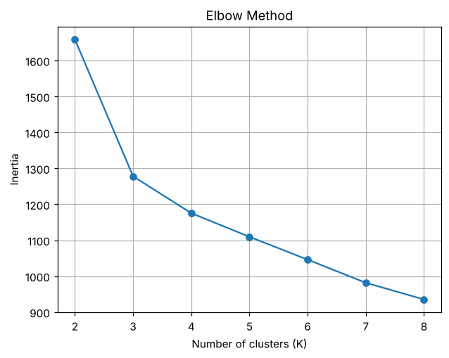
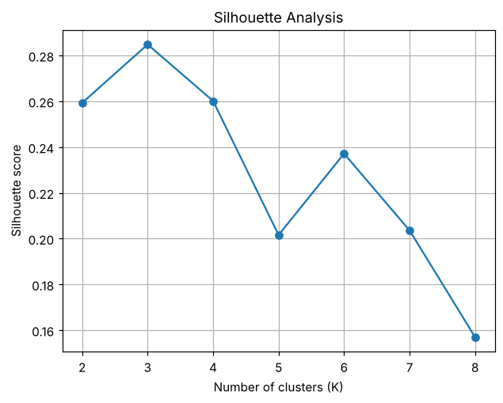
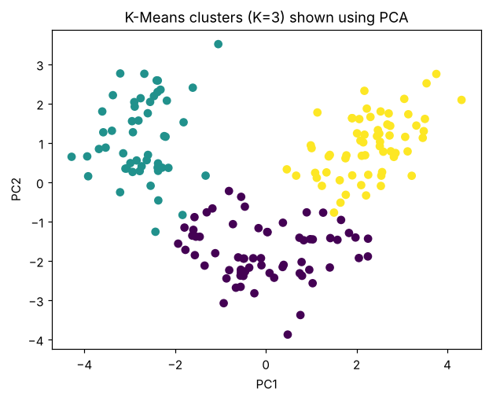

# Practical 8 — K-Means Clustering and the Optimal Number of Clusters

**Dataset:** UCI Wine (labels are *not* used for clustering) · **File:** [`practical_08_kmeans.py`](practical_08_kmeans.py)

## 1. Aim
Cluster the Wine data with K-Means, choose K using the **Elbow method** and **Silhouette score**, and visualize the clusters in 2-D using PCA.

## 2. Theory

### K-Means (unsupervised, centroid-based)
Goal: partition n points into K clusters minimizing the **within-cluster sum of squares (WCSS / inertia)**:

J = Σₖ Σ_{x∈Cₖ} ‖x − μₖ‖²

Algorithm (Lloyd's):
1. Initialize K centroids (sklearn uses **k-means++** for smart seeding).
2. **Assign** every point to its nearest centroid.
3. **Update** each centroid to the mean of its assigned points.
4. Repeat 2–3 until assignments stop changing (convergence to a *local* optimum).

`n_init=10` runs the algorithm 10 times with different seeds and keeps the best (lowest inertia). `random_state=42` makes it reproducible.

Limitations: K must be chosen in advance; assumes roughly spherical, similar-sized clusters; sensitive to scale and outliers → **standardize first**.

### Choosing K
* **Elbow method** – plot inertia vs K. Inertia always decreases with K; pick the "elbow" where improvement slows sharply.
* **Silhouette score** – for each point, s = (b − a) / max(a, b), where *a* = mean distance to its own cluster and *b* = mean distance to the nearest other cluster. Range −1…+1; **higher = better-separated clusters**. Choose K with the highest mean silhouette.

### PCA for visualization
13 features cannot be plotted, so the standardized data is projected on the first two principal components (PC1, PC2) just for display.

## 3. Code walkthrough
| Step | Explanation |
|---|---|
| Scale | `StandardScaler().fit_transform(X)`; the true labels `y` are loaded but unused. |
| Loop K = 2…8 | Fit K-Means, store `inertia_` and `silhouette_score`. |
| Plot 1 | Elbow curve (inertia vs K). |
| Plot 2 | Silhouette score vs K. |
| Best K | `silhouettes.index(max(silhouettes))` → position of the highest score, mapped back to the K value. |
| Final model | Refit K-Means with `best_k`, project to 2-D with PCA, scatter-plot coloured by cluster label. |

### Full code
```python
import matplotlib.pyplot as plt
import pandas as pd
from sklearn.datasets import load_wine
from sklearn.preprocessing import StandardScaler
from sklearn.cluster import KMeans
from sklearn.metrics import silhouette_score
from sklearn.decomposition import PCA

X, y = load_wine(return_X_y=True)
X_scaled = StandardScaler().fit_transform(X)

inertias, silhouettes = [], []
k_values = range(2, 9)
for k in k_values:
    km = KMeans(n_clusters=k, random_state=42, n_init=10)
    labels = km.fit_predict(X_scaled)
    inertias.append(km.inertia_)
    silhouettes.append(silhouette_score(X_scaled, labels))

plt.plot(list(k_values), inertias, marker="o")
plt.xlabel("Number of clusters (K)")
plt.ylabel("Inertia")
plt.title("Elbow Method")
plt.grid(True)
plt.show()

plt.plot(list(k_values), silhouettes, marker="o")
plt.xlabel("Number of clusters (K)")
plt.ylabel("Silhouette score")
plt.title("Silhouette Analysis")
plt.grid(True)
plt.show()

best_k = list(k_values)[int(silhouettes.index(max(silhouettes)))]
kmeans = KMeans(n_clusters=best_k, random_state=42, n_init=10)
labels = kmeans.fit_predict(X_scaled)
X_2d = PCA(n_components=2).fit_transform(X_scaled)
plt.scatter(X_2d[:, 0], X_2d[:, 1], c=labels)
plt.title(f"K-Means clusters (K={best_k}) shown using PCA")
plt.xlabel("PC1")
plt.ylabel("PC2")
plt.show()
print("Selected K:", best_k)
print("Silhouette score:", max(silhouettes))
```

### Output
```text
Selected K: 3
Silhouette score: 0.2848589191898987
```

| Elbow method | Silhouette analysis | Clusters (PCA view) |
|---|---|---|
|  |  |  |

## 4. Interpretation
* Silhouette is highest at **K = 3 (≈ 0.285)**, and the elbow also bends around K = 3.
* This agrees with the dataset, which really contains **3 wine cultivars**.
* A silhouette of ~0.28 indicates *moderate* structure: clusters are reasonably separated but with some overlap, visible in the PCA plot.

## 5. Viva questions
* **Why scale before K-Means?** It uses Euclidean distance; large-scale features would dominate.
* **Does inertia ever increase with K?** No — so we look for the elbow, not the minimum.
* **K-Means vs DBSCAN?** K-Means needs K and finds spherical clusters; DBSCAN needs eps/min_samples, finds arbitrary shapes and noise.

## 6. Notes from debugging
Runs without errors; same K and silhouette as the notebook. The plots display only via `plt.show()` (in a headless run use a non-interactive backend, e.g. `MPLBACKEND=Agg`).
