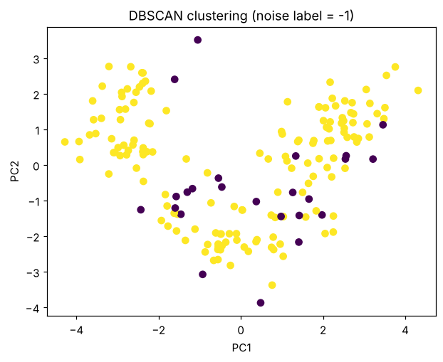

# Practical 9 — Density-Based Clustering using DBSCAN

**Dataset:** UCI Wine · **File:** [`practical_09_dbscan.py`](practical_09_dbscan.py)

## 1. Aim
Apply DBSCAN to find dense clusters and noise points, and study how **eps** and **min_samples** change the result.

## 2. Theory

### DBSCAN — Density-Based Spatial Clustering of Applications with Noise
Clusters are **dense regions separated by sparse regions**. Two parameters:
* **eps (ε)** – neighbourhood radius.
* **min_samples** – minimum points (including itself) inside ε for a point to be a *core* point.

Point types:
| Type | Definition |
|---|---|
| **Core** | ≥ `min_samples` points within ε |
| **Border** | within ε of a core point but not core itself |
| **Noise (outlier)** | neither → label **−1** |

Algorithm: pick an unvisited core point → grow a cluster by repeatedly adding all density-reachable points → continue until every point is visited.

### Effect of parameters
* **eps too small** → most points become noise, many tiny clusters.
* **eps too large** → clusters merge into one.
* **min_samples larger** → stricter, more noise. A common rule of thumb: `min_samples ≥ dimensions + 1`; choose eps from a **k-distance plot**.

### Advantages / disadvantages
✔ no need to specify K · finds arbitrary shapes · detects outliers  
✘ sensitive to eps/min_samples · struggles with varying densities and **high-dimensional data** (distances become similar — the "curse of dimensionality").

## 3. Code walkthrough
| Step | Explanation |
|---|---|
| Scale | Standardize — DBSCAN is distance-based. |
| Fit | `DBSCAN(eps=2.5, min_samples=5).fit_predict(X_scaled)` returns one label per sample. |
| Count | `set(labels) - {-1}` = real clusters; `np.sum(labels == -1)` = noise points. |
| Plot | PCA 2-D projection coloured by label (noise = −1 gets its own colour). |
| Sensitivity loop | Repeats DBSCAN for eps = 1.5, 2.0, 2.5, 3.0 and prints cluster/noise counts. |

### Full code
```python
import numpy as np
import matplotlib.pyplot as plt
from sklearn.datasets import load_wine
from sklearn.preprocessing import StandardScaler
from sklearn.decomposition import PCA
from sklearn.cluster import DBSCAN

X, y = load_wine(return_X_y=True)
X_scaled = StandardScaler().fit_transform(X)

# eps is data-dependent; experiment with nearby values if all points
# become noise or a single cluster is produced.
dbscan = DBSCAN(eps=2.5, min_samples=5)
labels = dbscan.fit_predict(X_scaled)

cluster_labels = set(labels) - {-1}
noise_count = int(np.sum(labels == -1))
print("Number of clusters:", len(cluster_labels))
print("Number of noise points:", noise_count)
print("Cluster labels:", np.unique(labels))

X_2d = PCA(n_components=2).fit_transform(X_scaled)
plt.scatter(X_2d[:, 0], X_2d[:, 1], c=labels)
plt.title("DBSCAN clustering (noise label = -1)")
plt.xlabel("PC1")
plt.ylabel("PC2")
plt.show()

# Parameter sensitivity experiment
for eps in [1.5, 2.0, 2.5, 3.0]:
    lab = DBSCAN(eps=eps, min_samples=5).fit_predict(X_scaled)
    print(f"eps={eps}: clusters={len(set(lab)-{-1})}, "
          f"noise={np.sum(lab == -1)}")
```

### Output
```text
Number of clusters: 1
Number of noise points: 24
Cluster labels: [-1  0]
eps=1.5: clusters=0, noise=178
eps=2.0: clusters=5, noise=85
eps=2.5: clusters=1, noise=24
eps=3.0: clusters=1, noise=11
```



## 4. Interpretation (parameter effect)
| eps | Clusters | Noise | Meaning |
|---|---|---|---|
| 1.5 | 0 | 178 | too small — everything is noise |
| 2.0 | 5 | 85 | fragmented, many outliers |
| **2.5** | 1 | 24 | one dense cluster + outliers |
| 3.0 | 1 | 11 | even fewer outliers |

* The chosen setting (eps = 2.5) finds **1 cluster and 24 noise points**. This does *not* recover the 3 true wine classes, because the 3 cultivars overlap and the data is 13-dimensional with roughly uniform density — a weakness of DBSCAN here compared with K-Means (Practical 8).
* This is a good illustration of parameter sensitivity: the result changes drastically between eps 1.5 → 2.0 → 2.5.

## 5. Viva questions
* **What does label −1 mean?** The point is noise/outlier.
* **How to choose eps?** From a k-distance (nearest-neighbour distance) plot; look for the knee.
* **Can DBSCAN find non-spherical clusters?** Yes (e.g. moons, rings).

## 6. Notes from debugging
Runs without errors; output identical to the notebook. The comment in the code itself advises trying nearby eps values if the result is one cluster or all noise.
